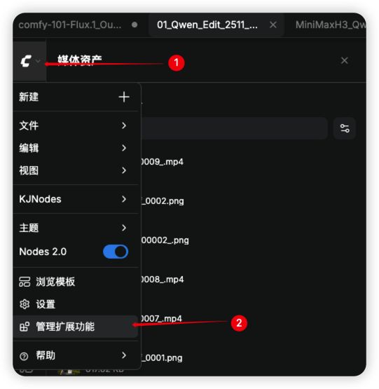
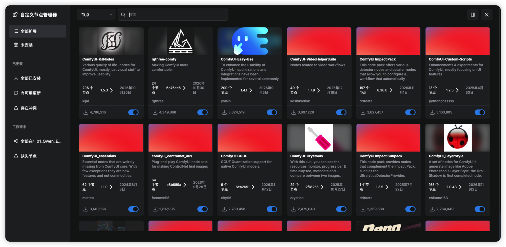

[ComfyUI 注册表](https://registry.comfy.org/zh)




**有一部分内容确实还是旧写法，但不能把 ComfyUI 的 Custom Nodes 文档整体判断为“已经过时”。**我核对了官方文档和当前仓库：官方“创建第一个节点”教程仍在讲 V1 接口，仓库里的示例已经采用 V3，而当前加载器同时支持两者。这确实容易让人读起来觉得前后不一致。[ComfyUI](https://docs.comfy.org/custom-nodes/walkthrough?utm_source=chatgpt.com)

你说的“添加自定义节点”可能有两个意思：

- **安装别人写好的节点包**：主要看 ComfyUI Manager 的安装与管理教程。
- **自己用 Python 写一个新节点**：我建议从 **V3 官方指南＋当前官方示例**开始。

下面把两条路线都整理给你。

## 一、哪些内容旧了，哪些仍然可以用？

| 你在教程里看到的内容                                                 | 现在应该怎么理解                                                                                               |
| -------------------------------------------------------------------- | -------------------------------------------------------------------------------------------------------------- |
| `INPUT_TYPES`、`RETURN_TYPES`、`FUNCTION`、`NODE_CLASS_MAPPINGS`     | 这是 **V1 节点接口**，当前仍受支持，适合阅读和维护现有节点                                                     |
| `io.ComfyNode`、`define_schema()`、`execute()`、`comfy_entrypoint()` | 这是 **V3 节点接口**，建议新写节点优先学习这套                                                                 |
| 直接修改 `nodeType.prototype` 中的方法                               | 要逐项检查；官方已经将文档里的“原型劫持”模式标为弃用，建议改用相应的公开 API 或扩展钩子                        |
| 教程要求先把 Manager 克隆到 `custom_nodes`                           | 属于仍有文档记录的旧安装方式；当前 Desktop 已随安装提供 Manager，较新的手动安装、Portable 版本则有新的启用方式 |

上述区别分别可以在官方迁移指南、前端钩子文档及 Manager 安装页中核对。官方还明确表示，未来的节点功能扩展将放在 V3 上。[ComfyUI](https://docs.comfy.org/custom-nodes/v3_migration?utm_source=chatgpt.com)

**因此，旧 Python 教程仍有学习价值；新项目的接口写法、前端扩展方式和安装入口，需要对照当前文档。**

## 二、值得看的 YouTube 教程

下面三部各有用途。我核对了作者提供的标题、简介和章节信息；选择时应按学习目标区分。

### 1. 安装现成节点：Fictitiousness

**[ComfyUI for Beginners Pt. 2: Level Up with Custom Nodes & Image-to-Image](https://www.youtube.com/watch?v=rAWL7r3XLOA)**  
作者：Fictitiousness｜发布时间：2026-02-03

主要介绍 Manager、自定义节点包的安装和管理，以及导入工作流后如何处理缺失节点；后半部分转向图生图。

适合你想解决这些问题时看：

- 如何把别人写的节点装进 ComfyUI？
- 导入工作流后出现 Missing Custom Nodes，应该怎么办？
- 节点包安装好后，如何用于工作流？

这部适合先建立安装流程的认识，具体 Manager 入口再对照后面的官方新界面文档。[YouTube](https://www.youtube.com/watch?v=rAWL7r3XLOA&utm_source=chatgpt.com)

### 2. 借助 AI 写第一个节点：Pixaroma

**[Vibe Code Your First ComfyUI Custom Node Step by Step — Ep12](https://www.youtube.com/watch?v=oiiCkrX8hq4)**  
作者：Pixaroma｜发布时间：2026-04-08

它会带你理解节点由哪些文件组成、文件放在哪里，再用 Gemini、Claude 辅助编写节点，并在 ComfyUI 中加载和测试。作者的课程页也提供相关资源。[YouTube](https://www.youtube.com/watch?v=oiiCkrX8hq4&utm_source=chatgpt.com)

**适合先把一个小功能做出来。**不过，不要仅凭视频比较新就默认它使用 V3；生成代码时，可以明确要求 AI 对照官方 V3 接口。

### 3. 手动理解 Python 节点结构：Code Crafters Corner

**[Create Your Own Custom Nodes in ComfyUI](https://www.youtube.com/watch?v=RSp9_fh3JoI)**  
作者：Code Crafters Corner｜发布时间：2023-12-16

这部从官方示例节点开始解释，再编写一个将正、负提示词编码放在一起的节点，讲清输入、输出和处理函数如何连接。[YouTube](https://www.youtube.com/watch?v=RSp9_fh3JoI&utm_source=chatgpt.com)

**它比较旧，适合学习机制和读懂 V1 节点代码。**你前面正在学习 CLIP、CONDITIONING、KSampler，这个例子也比较容易和现有知识连起来。新写节点时，再用 V3 迁移表转换接口。

### 一个更贴近当前 V3 的图文教程

**[How to Make a ComfyUI Custom Node from Scratch — Model Chief](https://modelchief.com/blog/how-to-build-a-comfyui-custom-node/)**

2026-09-25 发布、9 月 26 日更新。它用“从三张图片中选择一张”作为例子，提供完整代码，并逐步解释 `define_schema`、`execute`、注册入口、重启加载，以及后续的惰性输入。文章明确采用 V3。[modelchief.com](https://modelchief.com/blog/how-to-build-a-comfyui-custom-node/?utm_source=chatgpt.com)

**如果你真正想自己开发，我建议先读这篇，再对照官方 V3 指南。**图文代码比跟着视频暂停抄写更方便。

## 三、安装别人写好的自定义节点，当前应该怎么做？

### 先确认你使用的环境

| 使用环境                        | 自定义节点安装方式                                         |
| ------------------------------- | ---------------------------------------------------------- |
| 本地 ComfyUI Desktop            | 可以安装，Manager 随安装提供                               |
| 本地手动安装 / Windows Portable | 可以安装，通过 Manager 或 Git 手动安装                     |
| **官方 Comfy Cloud**            | **目前不能自行安装任意节点包**，只能使用平台维护的节点集合 |

官方 Cloud 文档明确写明：用户不能自行安装自己的节点包；工作流依赖不支持的包时，需要替换节点，或在本地运行。假如你是在 `cloud.comfy.org` 操作，找不到本地教程中的安装入口，可能就是这个原因。[ComfyUI](https://docs.comfy.org/manager/install?utm_source=chatgpt.com)

### 方法 A：使用 Manager

对于本地环境，推荐按这个顺序操作：

1. 打开 **Manager／节点管理**。
2. 搜索节点包名称，或者切换为搜索单个节点。
3. 打开详情，确认仓库、用途和版本。
4. 点击 **Install**。
5. 安装完成后重启 ComfyUI，再刷新页面。
6. 在画布中搜索节点名称，将它加入工作流。

如果是导入工作流后缺节点，可以使用 Manager 的缺失节点提示或筛选来定位需要安装的包。当前新界面支持分别搜索 **Node Pack** 和 **Individual Node**。[ComfyUI](https://docs.comfy.org/manager/pack-management?utm_source=chatgpt.com)

对应官方文档：

- **[Manager 新界面：搜索、安装、更新、查找缺失节点](https://docs.comfy.org/manager/pack-management)**
- **[自定义节点安装指南](https://docs.comfy.org/installation/install_custom_node)**

还有一个容易造成困惑的变化：**新 Manager 界面面向 Registry 中的节点包，不提供旧教程中的任意 Git 地址安装入口。**找不到这个按钮时，可按官方手动安装流程处理。[ComfyUI](https://docs.comfy.org/manager/pack-management?utm_source=chatgpt.com)

### 方法 B：手动安装 GitHub 节点包

基本流程是：

1. 找到**当前正在运行的 ComfyUI 实例**的 `custom_nodes` 目录。
2. 将节点仓库克隆到这个目录下。
3. 按仓库 README 安装依赖和所需模型。
4. 重启 ComfyUI 后端，刷新页面。
5. 如果节点没有出现，检查启动日志中的 `IMPORT FAILED` 或具体导入错误。

这里最常见的问题是：**节点代码放对了，但依赖装到了另一个 Python 环境。**官方明确要求将依赖安装在运行 ComfyUI 的环境中。Windows Portable 应使用它自带的 `python_embeded`；手动安装则使用启动 ComfyUI 的虚拟环境。[ComfyUI](https://docs.comfy.org/installation/install_custom_node?utm_source=chatgpt.com)

如果你是较新的手动安装版本，缺少 Manager，可在**已激活 ComfyUI 虚拟环境、且位于 ComfyUI 根目录**时按官方方式启用：

```bash
python -m pip install -r manager_requirements.txt
python main.py --enable-manager
```

Desktop、Portable 的具体操作看 **[Manager 安装与启用文档](https://docs.comfy.org/manager/install)**。[ComfyUI](https://docs.comfy.org/manager/install?utm_source=chatgpt.com)

## 四、如果你要自己编写节点：从一个简单的 V3 节点开始

对你目前正在学习的图像数据流，我建议第一个练习做 **“输入一张图，水平翻转，再输出”**。这样可以直接观察输入和输出，无需先处理模型加载或视频推理。

一个基础 Python 节点需要定义四件事：

| 部分                 | 作用                             |
| -------------------- | -------------------------------- |
| `define_schema()`    | 描述节点名称、分类、输入和输出   |
| `execute()`          | 真正处理输入数据                 |
| `get_node_list()`    | 告诉 ComfyUI，这个包提供哪些节点 |
| `comfy_entrypoint()` | 让 ComfyUI 加载这个扩展包        |

这是 V3 的基本结构。普通图像处理节点可以只写 Python；需要特殊界面交互时，再加入 JavaScript。[ComfyUI](https://docs.comfy.org/custom-nodes/v3_migration?utm_source=chatgpt.com)

### 1. 创建文件

在当前运行实例的 `custom_nodes` 下，创建 `aurixx_demo` 文件夹，并在其中创建：

`custom_nodes/aurixx_demo/__init__.py`

填入下面的最小示例：

```python
from comfy_api.latest import ComfyExtension, io


class AurixxFlipImage(io.ComfyNode):
    @classmethod
    def define_schema(cls) -> io.Schema:
        return io.Schema(
            node_id="AurixxFlipImage",
            display_name="Aurixx 水平翻转",
            category="Aurixx",
            inputs=[io.Image.Input("image")],
            outputs=[io.Image.Output()],
        )

    @classmethod
    def execute(cls, image) -> io.NodeOutput:
        # IMAGE 的维度为：批次、高度、宽度、通道
        # 沿宽度方向翻转
        result = image.flip(dims=[2])
        return io.NodeOutput(result)


class AurixxDemoExtension(ComfyExtension):
    async def get_node_list(self) -> list[type[io.ComfyNode]]:
        return [AurixxFlipImage]


async def comfy_entrypoint() -> ComfyExtension:
    return AurixxDemoExtension()
```

这里的 `image` 是图像张量，ComfyUI 的 `IMAGE` 使用 `[B, H, W, C]` 布局，因此第 `2` 个维度对应宽度。接口结构按官方 V3 示例编写；这段示例没有在你的本地环境中实际运行。[ComfyUI](https://docs.comfy.org/custom-nodes/walkthrough?utm_source=chatgpt.com)

### 2. 重启并连接

重启 **ComfyUI 后端进程**，刷新页面，搜索 `Aurixx`，连接：

**Load Image → Aurixx 水平翻转 → Preview Image**

上传一张图片并运行，就能检查效果。修改 Python 文件后，同样需要重新加载后端；只刷新浏览器不会重新导入 Python 模块。[raw.githubusercontent.com](https://raw.githubusercontent.com/Comfy-Org/ComfyUI/master/nodes.py?utm_source=chatgpt.com)

这个练习会让你直接看到：**自定义节点就是为某种输入数据定义一个处理步骤，再把结果交给后续节点。**

## 五、建议收藏的官方参考文档

| 文档                                                                                                                                     | 主要用途                                    |
| ---------------------------------------------------------------------------------------------------------------------------------------- | ------------------------------------------- |
| **[Custom Nodes 开发入口](https://docs.comfy.org/custom-nodes/intro)**                                                                   | 区分 Python 后端、JavaScript 前端和节点发布 |
| **[创建第一个节点](https://docs.comfy.org/custom-nodes/walkthrough)**                                                                    | 理解完整开发过程；注意示例仍采用 V1         |
| **[V3 迁移指南](https://docs.comfy.org/custom-nodes/v3_migration)** ／ **[中文版](https://docs.comfy.org/zh/custom-nodes/v3_migration)** | 学习当前 V3 写法，对照旧教程转换接口        |
| **[官方仓库中的节点示例](https://github.com/Comfy-Org/ComfyUI/blob/master/custom_nodes/example_node.py.example)**                        | 查看当前仓库实际使用的示例结构              |
| **[JavaScript 扩展钩子](https://docs.comfy.org/custom-nodes/js/javascript_hooks)**                                                       | 开发特殊交互界面时查阅                      |

这些入口分别覆盖开发路线、V1 入门、V3 接口和前端扩展。[ComfyUI](https://docs.comfy.org/custom-nodes/intro?utm_source=chatgpt.com)

**按你现在的学习进度，我建议先跑通上面的 `IMAGE → IMAGE` 小节点，再做“图片选择”“亮度调整”或“提示词组合”。**等输入类型、执行函数和输出连接都清楚后，再去封装视频模型或外部 API，整个链路会容易理解得多。
