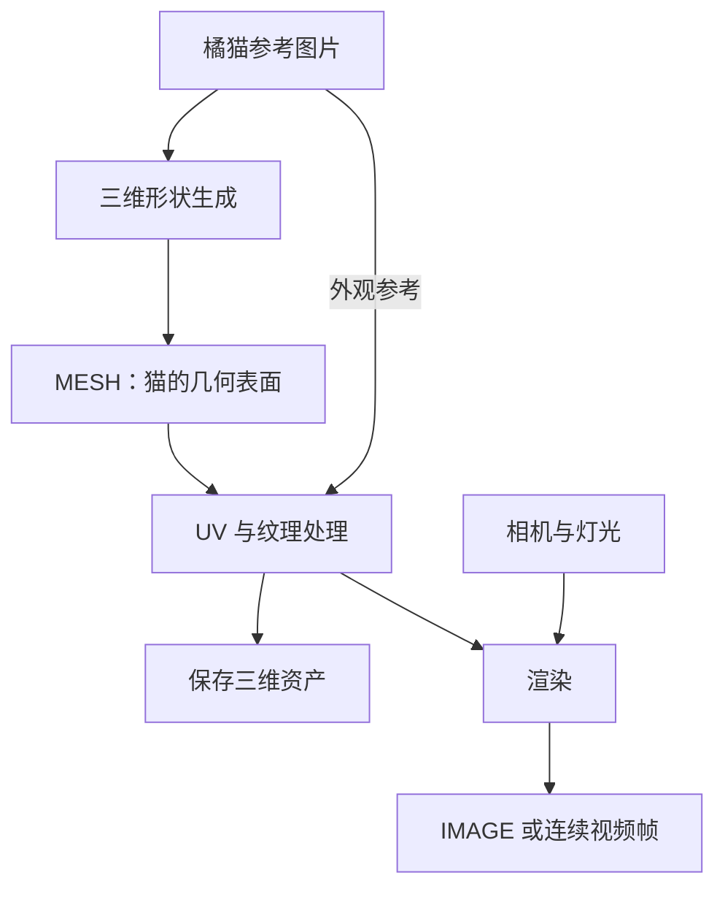

| 原名称 / 接口类型             | 颜色                | 实际传递的内容                         | 在生成中的作用                                           |
| ----------------------------- | ------------------- | -------------------------------------- | -------------------------------------------------------- |
| diffusion model / `MODEL`     | 淡紫色 lavender     | 已加载的图像生成模型对象               | 供采样器调用，预测如何更新当前潜在表示，逐步形成图像     |
| CLIP model / `CLIP`           | 黄色 yellow         | 已加载的文本编码器对象                 | 将提示词转换成生成模型可使用的数值特征                   |
| VAE model / `VAE`             | 玫瑰色 rose         | 已加载的图像编码、解码模型对象         | 在像素图像和潜在表示之间转换                             |
| conditioning / `CONDITIONING` | 橙色 orange         | 引导生成的条件数据，例如提示词编码结果 | 告诉模型这次生成应符合什么要求                           |
| latent image / `LATENT`       | 粉色 pink           | 潜在空间中的图像表示及相关信息         | 作为采样器处理的主要对象，保存生成过程中的图像状态       |
| pixel image / `IMAGE`         | 蓝色 blue           | 像素数组，通常包含 RGB 通道            | 用于预览、保存、缩放、调色，也可以作为图生图输入         |
| mask / `MASK`                 | 绿色 green          | 每个位置的选择程度或作用权重           | 指定哪些区域需要重绘、合成、调整或保留                   |
| number / `INT`、`FLOAT`       | 灰色 gray           | 整数或浮点数                           | 设置种子、步数、尺寸、引导强度等参数                     |
| mesh / `MESH`                 | 亮绿色 bright green | 三维网格，例如顶点和面                 | 用于生成、处理、导出或渲染三维物体；普通文生图通常用不到 |

## Mask

| 数值               | 常见含义               |
| ------------------ | ---------------------- |
| `0`，显示为黑色    | 不选中、不施加操作     |
| `1`，显示为白色    | 完全选中、施加操作     |
| `0～1`，显示为灰色 | 部分作用，用于柔和过渡 |

## Mesh

| 信息     | 负责什么                         | 对橘猫的作用                     |
| -------- | -------------------------------- | -------------------------------- |
| 几何网格 | 物体的形状和轮廓                 | 猫头多圆、耳朵多尖、尾巴怎样弯曲 |
| UV 坐标  | 三维表面与二维贴图之间的对应关系 | 告诉软件，贴图上的哪一块对应猫背 |
| 纹理贴图 | 表面颜色或其他属性的图像数据     | 橘色毛发、深色条纹、鼻子颜色     |
| 材质     | 表面如何响应光照                 | 眼睛是否有光泽，表面是否粗糙     |
| 法线     | 表面的朝向信息                   | 影响明暗和表面的平滑观感         |
| 顶点颜色 | 直接记录在顶点上的颜色           | 提供另一种着色方式               |

| 检查项    | 关注的问题                           |
| --------- | ------------------------------------ |
| 形状      | 猫头、四肢和尾巴是否合理             |
| 完整性    | 是否有破洞、漂浮碎片或不该连接的部位 |
| 面数      | 是否过于粗糙，或者过密导致处理困难   |
| UV 与纹理 | 是否有颜色，条纹是否拉伸或错位       |
| 表面朝向  | 是否出现异常黑面或从某些角度消失的面 |
| 动画需求  | 是否有合适的拓扑、绑定和变形能力     |
