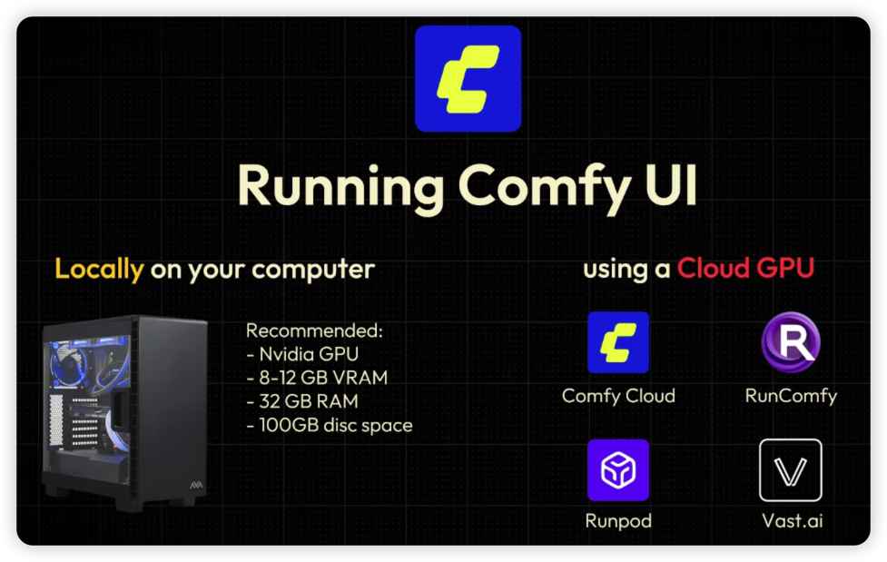

**如果按你最近经常跑视频、导入工作流、安装自定义节点的用法来选，我优先推荐 RunPod；愿意挑机器、进一步压低价格，就比较 Vast.ai 和 AutoDL。**  
如果更重视打开网页就能用、平时主要在研究和修改工作流，Comfy Cloud 也值得考虑。RunComfy 的优势是现成环境和工作流服务。

下面是我按 **2026 年 11 月 11 日**查到的官方公开报价整理的比较。美元价格均为 USD；实际库存、存储和模型 API 费用需要分别计算。

## 一、图中这四家，怎么选？

| 平台                                                    | 当前公开价格或计费方式                                                                   | 自定义能力                                   | 我的建议                                   |
| ------------------------------------------------------- | ---------------------------------------------------------------------------------------- | -------------------------------------------- | ------------------------------------------ |
| **[RunPod](https://www.runpod.io/gpu-models/rtx-4090)** | RTX 4090 24GB：**Community $0.34/小时；Secure $0.89/小时**，地区库存不同                 | 有官方 ComfyUI 模板、Manager，可自行维护环境 | **最适合你作为常用云端环境**               |
| **[Vast.ai](https://vast.ai/pricing)**                  | 市场定价，主机之间不同；需比较 GPU、磁盘和流量的合计费用                                 | 可以使用 ComfyUI 模板、自行配置环境          | **适合愿意挑选主机、追求低价的人**         |
| **[Comfy Cloud](https://comfy.org/pricing/)**           | 月付 **$20 起**；GPU 额度按充值汇率折算约 **$4.54/实际运行小时**，使用 96GB RTX 6000 Pro | 支持平台维护的节点，不能任意自行安装节点     | **适合使用零散、希望少维护环境的人**       |
| **[RunComfy](https://www.runcomfy.com/pricing)**        | 24GB A10G/A5000：**$1.75/小时**；48GB A6000：**$2.50/小时**；订阅 Pro 后有折扣           | 支持上传模型、安装自定义节点、保存工作流环境 | **适合愿意为现成工作流和环境管理付费的人** |

以上价格和功能分别来自各平台官方页面。RunPod 的 $0.34 与 $0.89 是两种服务类别的报价，并非同一档机器随意浮动。[Runpod](https://www.runpod.io/gpu-models/rtx-4090?utm_source=chatgpt.com)

这里有两个区别，会直接改变最终账单：

- **显卡不同。** Comfy Cloud 是 96GB 显存的 RTX 6000 Pro，不能直接拿它与 24GB 的 4090 比小时价，再推断每条视频的成本。
- **计费时间不同。** Comfy Cloud 在工作流实际运行时扣 GPU 额度；编辑工作流、下载模型不扣这部分额度。RunPod、Vast.ai、RunComfy 的普通交互式机器则按实例运行时间计费，开着机器研究节点也会产生费用。[Comfy Cloud](https://comfy.org/pricing/?utm_source=chatgpt.com)

## 二、为什么我更推荐你先用 RunPod？

你最近经常在调整 **WanVideo、Qwen 图像编辑、SAM3 和各种自定义节点**。这种用法需要能安装依赖、调整版本、保留自己的环境。

RunPod 官方提供预装 ComfyUI 和 Manager 的模板，也提供 SSH 入口；4090 等常规显卡与 5090 等 Blackwell 显卡有不同的模板可选。这比较接近你熟悉的“自己维护一台远程机器”的方式。[Runpod Documentation](https://docs.runpod.io/tutorials/pods/comfyui?utm_source=chatgpt.com)

### 可以先比较这三种 GPU

| GPU           | 显存 | Community Cloud | Secure Cloud | 我会怎样选                         |
| ------------- | ---: | --------------: | -----------: | ---------------------------------- |
| **RTX 4090**  | 24GB |  **$0.34/小时** |   $0.89/小时 | 工作流能装进 24GB，先从这里开始    |
| **RTX 5090**  | 32GB |  **$0.69/小时** |   $1.19/小时 | 24GB 不够、32GB 能解决问题时再考虑 |
| **RTX A6000** | 48GB |  **$0.33/小时** |   $0.59/小时 | 预算有限、主要缺显存时值得测试     |

这些都是官方按量目录价，供应情况随地区变化。**A6000 显存更大，不代表它跑你的工作流一定比 4090 更快**；应以相同工作流的实际耗时为准。[Runpod](https://www.runpod.io/gpu-models/rtx-4090?utm_source=chatgpt.com)

### 用同一种显卡比较，更容易看出服务差价

以 **A6000 48GB、一个月开机 20 小时**为例：

| 方案              |                                       按公开费率计算 |
| ----------------- | ---------------------------------------------------: |
| RunPod Community  |                                     **$6.60 算力费** |
| RunPod Secure     |                                    **$11.80 算力费** |
| RunComfy 按量     |                                    **$50.00 机器费** |
| RunComfy Pro 月付 | **$59.79**：$29.99 月费＋$39.80 使用费－$10 包含额度 |

这是根据官方价格做的计算，**还没有统一加入存储、CPU 配置及服务内容的差异**。RunComfy Pro 包含 200GB 存储、每月 $10 余额和其他权益，所以不能只把它的月费视为 GPU 折扣费；但如果使用量很小，订阅 Pro 未必更省钱。[Runpod](https://www.runpod.io/gpu-models/rtx-a6000?utm_source=chatgpt.com)

**对你来说，我会先用 RunPod 按量试跑常用工作流，再决定是否需要长期保存一套云端环境。**

## 三、Comfy Cloud 的 $20/月，到底能跑多久？

这一点最容易被套餐页面上的“可生成多少视频”误导。

当前 Cloud GPU 消耗速度为 **0.266 credits/秒**，充值换算为 **$1＝211 credits**，因此：

\[
\frac{0.266\times3600}{211}
\approx \$4.54/\text{实际 GPU 运行小时}
\]

这是额度的价值换算，并不表示每月只用一分钟就可以只付一分钟的钱；订阅仍有月费。[Comfy Org Knowledge Base](https://support.comfy.org/articles/5846341390-how-credits-work-in-comfy?utm_source=chatgpt.com)

假设所有套餐额度都用于 Cloud GPU：

| 月付套餐 |     月费 |       每月额度 | 约可用 GPU 时间 |
| -------- | -------: | -------------: | --------------: |
| Standard |  **$20** |  4,200 credits |   **4.39 小时** |
| Creator  |  **$35** |  7,400 credits |   **7.73 小时** |
| Pro      | **$100** | 21,100 credits |  **22.03 小时** |

这些时间是根据官方额度计算的。如果同时使用付费 Partner Nodes，也会消耗同一余额，可用于 GPU 的时间就会减少。官网显示的 $16／$28／$80 则是年付折算月价，需要预付全年。[comfy.org](https://comfy.org/minimax-h3/?utm_source=chatgpt.com)

### 哪种使用方式适合它？

比如，你一天在画布里研究、连线、看教程两小时，但真正点击生成只有十几分钟。Comfy Cloud 的“编辑期间不扣 GPU 额度”就有价值；它还省去了维护模型和节点环境的时间。[by Robin](https://blog.comfy.org/p/comfy-cloud-new-features-and-pricing?utm_source=chatgpt.com)

但你需要留意两项限制：

1. **不能任意安装自定义节点。** 当前 Cloud 使用平台预装、维护的节点集合，缺少的节点需要申请支持。
2. **单次工作流有时长限制。** Standard、Creator 最长 30 分钟；Pro 最长 1 小时，超时会取消。长视频工作流尤其要先验证。[support.comfy.org](https://support.comfy.org/articles/6791455062-custom-nodes-on-cloud?utm_source=chatgpt.com)

因此，**你如果想买 Comfy Cloud，先把现在最常用的 JSON 导进去，检查节点和模型是否齐全。** 官方目前提供新用户 5 次免费运行，可以用来做这一步。[Comfy Cloud](https://comfy.org/pricing/?utm_source=chatgpt.com)

## 四、其他平台，我会补充这三个

### 1. AutoDL：值得认真比较的低价方案

[AutoDL](https://www.autodl.com/) 官方首页公开展示过以下价格：

| GPU          | 显存 |  官方页面展示价 |
| ------------ | ---: | --------------: |
| RTX 4090     | 24GB | **￥1.88/小时** |
| RTX 5090     | 32GB | **￥2.78/小时** |
| RTX PRO 6000 | 96GB | **￥6.98/小时** |

**这里是公开展示价，页面有会员／普通用户切换及会员折扣，具体账号、机房和库存价格要以下单页为准。** 我本次读到了官方搜索快照，但没有核验登录后的实际订单价。[弹性、好用、省钱，GPU算力零售价格新标杆](https://api.autodl.com/?utm_source=chatgpt.com)

你会维护 Linux 和 Python 环境，AutoDL 对你有实际吸引力。需要把它当作自己配置的 GPU 实例使用：**开机就计费，下载模型、看教程也计费；付费扩容的数据盘关机后继续收费。**[autodl.com](https://www.autodl.com/docs/price/?utm_source=chatgpt.com)

如果你希望中文界面、人民币付款，并且可以接受自行维护环境，**我会把 AutoDL 和 RunPod 放在一起实际试跑比较**。

### 2. RunningHub：中文托管工作流候选

[RunningHub](https://www.runninghub.cn/) 提供 ComfyUI 工作流、图片视频创作和模型调用，适合希望直接在网页上使用现成工作流的人。[runninghub.cn](https://www.runninghub.cn/?utm_source=chatgpt.com)

不过，本次没有取得可可靠核实的当前网页会员套餐价，所以我不把它排成“最便宜”。它值得试用，但建议先用你的工作流确认：

- 所需节点和模型是否可用；
- 一次完整生成实际扣多少额度；
- 等待时间是否能接受。

### 3. Modal：适合你以后把工作流自动化

[Modal](https://modal.com/pricing) 的 Starter 当前无固定月费，包含 **每月 $30 的合格计算额度**。例如 L40S 的 GPU 基础费率约 **$1.95/小时**，CPU、内存另计；加载和容器保温期间也可能计费，缩容到零后才停止容器计算费用。[Modal](https://modal.com/pricing?utm_source=chatgpt.com)

如果你以后想把固定的 ComfyUI 工作流封装成“上传图片→自动生成视频”的程序，可以考虑它。**轻量使用时，免费计算额度很有吸引力；长期打开画布调节点，我仍会先选 RunPod 或 AutoDL。**

## 五、真正容易把预算拉高的是存储和空闲时间

### 1. 关掉 GPU，模型硬盘可能还在收费

以 RunPod 为例：

- 普通 Volume Disk：运行时 **$0.10/GB/月**，停止时 **$0.20/GB/月**。
- 标准 Network Volume：不足 1TB 时 **$0.07/GB/月**。
- 对 Pods 而言，Network Volume 当前只支持 **Secure Cloud**，并受数据中心位置限制。[Runpod Documentation](https://docs.runpod.io/pods/pricing?utm_source=chatgpt.com)

这意味着，保留 **100GB 模型**：

- 普通卷如果绝大多数时间处于停止状态，存储费接近 **$20/月**；
- 标准网络卷约 **$7/月**。

因此，**不能直接把 Community 的 $0.34/小时与 Secure 才支持的 $7/月网络卷拼成一个套餐来估算。**

如果每月只跑 20 小时，4090 Community 的算力费仅 $6.80，长期保留模型的存储费反而可能更高。

### 2. Vast.ai 要看包含磁盘和流量的总价

Vast.ai 的价格由各主机提供者决定，费用包括计算、存储和网络流量；实例停止后，存储仍会收费。[docs.vast.ai](https://docs.vast.ai/guides/instances/pricing?utm_source=chatgpt.com)

所以比较时，我会看：

> **完成你这个工作流，实际付了多少钱、花了多久、得到了多少条可用成片。**

低小时价的机器，如果模型下载慢、频繁换机器重新下载，或者显存不足导致大量卸载，也可能没有更省钱。测试时固定模型、分辨率、帧数和采样步数，比只比较 GPU 名称更有用。

## 六、结合你现有设备，我建议这样分配

**日常学习和调试：优先已有本机。**  
如果你之前那台双 4090 仍然可用，而且工作流能运行，我会先用它，并通过远程访问操作 ComfyUI。硬件已经买了，新增现金成本主要是电费；云端留给本机显存不够、需要同时跑更多任务，或不方便开机的时候。

**需要云端完整环境：先试 RunPod，再与 AutoDL、Vast.ai 比实际成片成本。**  
24GB 够用就从 4090 开始；主要缺显存，再测试 48GB A6000 或更大显存机型。你的自定义节点使用较多，环境可控性很有价值。

**希望打开网页就用：先试 Comfy Cloud，也可以试 RunningHub。**  
重点检查你的现有 JSON 能否正常运行，再决定订阅。

还有一个与你最近的 MiniMax H3 工作流直接相关的区别：**H3 目前同时有本地权重和 Partner Nodes 两条路径。** 如果你使用的是 Partner/API 节点，主要生成费用来自模型服务调用，换一家便宜 GPU 并不会直接降低这笔调用费；如果下载权重自己运行，GPU 租赁价格才是核心比较项。[comfy.org](https://comfy.org/minimax-h3/?utm_source=chatgpt.com)

**我给你的具体起点是：先拿现有的一条 WanVideo 或 Qwen 编辑工作流，在 RunPod Community 4090 上试跑；需要更大显存时再试 A6000 48GB。若更偏向人民币低价方案，就用同一工作流对测 AutoDL。先按量使用，等实际耗时、存储需求和节点兼容性都确认后，再考虑订阅或长期租用。**
