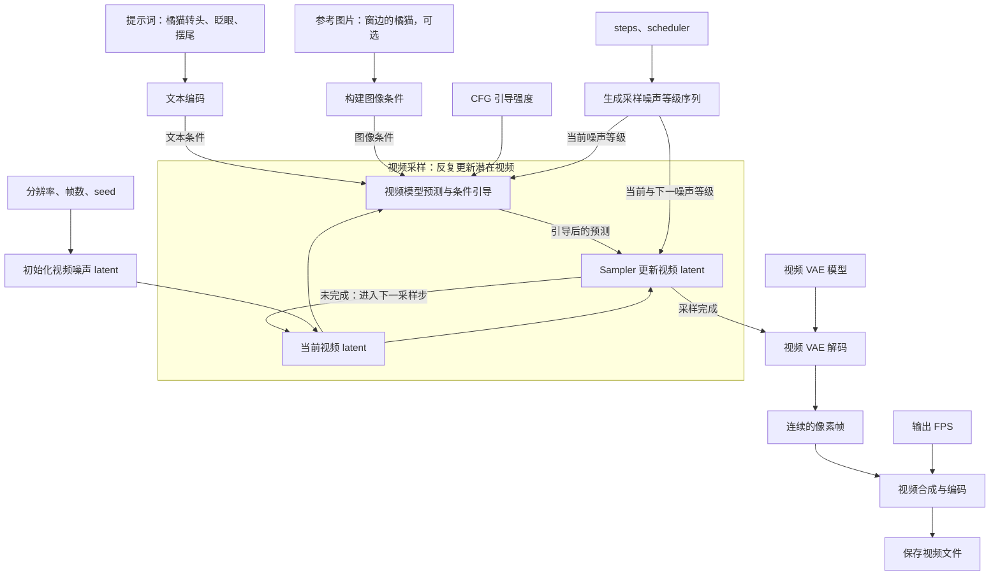

**`Image to Video (MiniMax H3)` 是 ComfyUI 官方的图生视频子图。** 你给它一张首帧图，写清楚接下来主体怎么动、镜头怎么走、现场有什么声音，它就会生成一段**带原生立体声音轨的 `VIDEO`**。还可以接一张尾帧图，让模型在两个指定画面之间生成过渡。你写的 “Miniax” 对应 **MiniMax**。[GitHub](https://github.com/Comfy-Org/workflow_templates/blob/main/blueprints/image_to_video_minimax_h3.json?utm_source=chatgpt.com)

按这个**带括号的官方子图**来分，界面有 **2 个图像输入、1 个视频输出、13 个可调参数**。如果你看到的节点右侧是 `positive` 和 `LATENT`，那是子图内部的 `MiniMax H3 Image to Video` 条件节点。[github.com](<https://github.com/Comfy-Org/ComfyUI/blob/master/blueprints/Image%20to%20Video%20(MiniMax%20H3).json?utm_source=chatgpt.com>)

### 一、输入接口

| 输入          | 类型          | 作用                                                                                                |
| ------------- | ------------- | --------------------------------------------------------------------------------------------------- |
| `first_frame` | `IMAGE`，可选 | **指定从什么画面开始。** 通常接 `Load Image`。例如接一张窗边橘猫的照片，再用提示词描述它如何转头。  |
| `last_frame`  | `IMAGE`，可选 | **指定最后落在哪个画面。** 例如接同一只猫已经转头望向窗外的照片。模型会尝试生成从首帧到尾帧的动作。 |

**这两个口处理图片比例的方式不同。** 首帧会直接缩放到目标宽高，比例不一致时，猫脸可能被拉宽或压扁；尾帧会保持比例缩放，再居中裁剪，边缘的物体可能被裁掉。做首尾帧过渡时，最好先把两张图处理成与目标视频相同的宽高比。只接首帧就能做普通图生视频，两张都留空则可仅凭文字生成。[GitHub](https://github.com/Comfy-Org/ComfyUI/blob/master/comfy_extras/nodes_minimax_h3.py?utm_source=chatgpt.com)

### 二、输出接口

| 输出    | 类型    | 包含什么，接到哪里                                                                                                                                                                                                                                                                         |
| ------- | ------- | ------------------------------------------------------------------------------------------------------------------------------------------------------------------------------------------------------------------------------------------------------------------------------------------ |
| `VIDEO` | `VIDEO` | 已按 **24 FPS** 组合好的视频和音轨。直接接 **`Save Video`** 就能保存。之前讲的 VHS `Video Combine` 适合接一批 `IMAGE` 帧；这个子图已经完成了音画合成。[GitHub](https://github.com/Comfy-Org/workflow_templates/blob/main/blueprints/image_to_video_minimax_h3.json?utm_source=chatgpt.com) |

### 三、节点自身的 13 个可调参数

下面用**独立蓝图保存的值**说明。若你打开的是完整示例工作流，`width`、`height` 也可能由外部尺寸节点接线提供，此时以接线传入的值为准。[GitHub](https://github.com/Comfy-Org/workflow_templates/blob/main/blueprints/image_to_video_minimax_h3.json?utm_source=chatgpt.com)

| 分类       | 参数                   | 蓝图值或常见配置           | 代表什么                                                                                                     |
| ---------- | ---------------------- | -------------------------- | ------------------------------------------------------------------------------------------------------------ |
| 内容       | `prompt`               | 空文本                     | 写**主体动作、镜头变化和声音**。首帧已经给出了猫的外观，提示词可以重点写“缓慢转头，镜头固定，窗外传来鸟鸣”。 |
| 画幅       | `width`                | `1344`                     | 输出视频宽度，单位为像素，按 32 的倍数设置。                                                                 |
| 画幅       | `height`               | `768`                      | 输出视频高度，同样按 32 的倍数设置。宽高一起决定画面比例。                                                   |
| 时长       | `duration`             | `5` 秒                     | 想生成多长的视频。子图会把秒数换算成帧，再对齐到 H3 支持的帧数，所以实际时长可能略长。                       |
| 随机性     | `noise_seed`           | 整数种子                   | 决定生成时的起始噪声。想比较两版提示词，固定种子；想看同一张首帧的不同动作演绎，就换种子。                   |
| 生成模型   | `unet_name`            | H3 `fl2va` 权重            | 选择负责生成的主模型。官方蓝图使用 `minimax_h3_fl2va_pruned_int8_convrot.safetensors`。                      |
| 条件编码   | `clip_name`            | H3 配套的 Qwen3-VL 编码器  | 读取提示词和参考图，形成生成条件。虽然接口叫 `clip_name`，官方配置选的是 **Qwen3-VL**。                      |
| 画面编解码 | `vae_name`             | H3 视频 VAE                | 把首尾帧编码成关键帧条件，也把生成的视频潜在空间数据解码成可见画面。不同官方模板使用的权重精度可能不同。     |
| 声音解码   | `audio_vae`            | H3 音频 VAE，通常为 `fp32` | 把生成的音频潜在空间数据解码成声音。这里选择的是**模型文件**；想让成片出现鸟鸣或对白，要在 `prompt` 中描述。 |
| 加速开关   | `turbo_mode`           | `false`                    | 关闭时，这份蓝图走常规 **20 步**采样；开启后，使用 Turbo LoRA 和下面的 `turbo_steps`。                       |
| 加速模型   | `lora_name`            | H3 FL2V Turbo 8-step LoRA  | 选择与图生视频匹配的加速 LoRA，供 Turbo 分支使用。                                                           |
| 加速强度   | `turbo_model_strength` | `1.0`                      | Turbo LoRA 对主模型的作用强度。想让猫转头更多、镜头推进更快，应先改动作描述。                                |
| 加速步数   | `turbo_steps`          | `8`                        | 开启 Turbo 后实际执行的采样步数。它影响推理耗时；视频有多少帧由 `duration` 决定。                            |

以上字段来自官方蓝图配置。常规模型、条件编码器、视频 VAE 和音频 VAE 各有分工；日常做同一套模型的内容测试，主要改前五项就够了。[GitHub](https://github.com/Comfy-Org/workflow_templates/blob/main/blueprints/image_to_video_minimax_h3.json?utm_source=chatgpt.com)

### 四、为什么填 `5` 秒，结果是 `124` 帧？

H3 按 **24 FPS** 生成，但支持的帧数遵循 **\(17k+5\)**。请求 5 秒时，先算出 \(5\times24=120\) 帧，再向上对齐到最近的有效值 **124 帧**。所以实际播放时长约为 **5.17 秒**。如果你在做需要精确卡点的口播，时间轴应以实际导出的帧数为准。[GitHub](https://github.com/Comfy-Org/workflow_templates/blob/main/blueprints/image_to_video_minimax_h3.json?utm_source=chatgpt.com)

以**窗边的橘猫**为例，只接首帧，`duration=5`，提示词可以写成：“镜头固定。橘猫先看着镜头，随后耳朵轻轻转动，缓慢转头看向窗外。能听到远处两声鸟鸣，室内安静。” 如果最后一帧必须是指定的侧脸构图，就把那张侧脸图接到 `last_frame`。**提示词描述这几秒里发生什么，尾帧图指定动作最后落在哪里。** [GitHub](https://github.com/Comfy-Org/ComfyUI/blob/master/comfy_extras/nodes_minimax_h3.py?utm_source=chatgpt.com)

