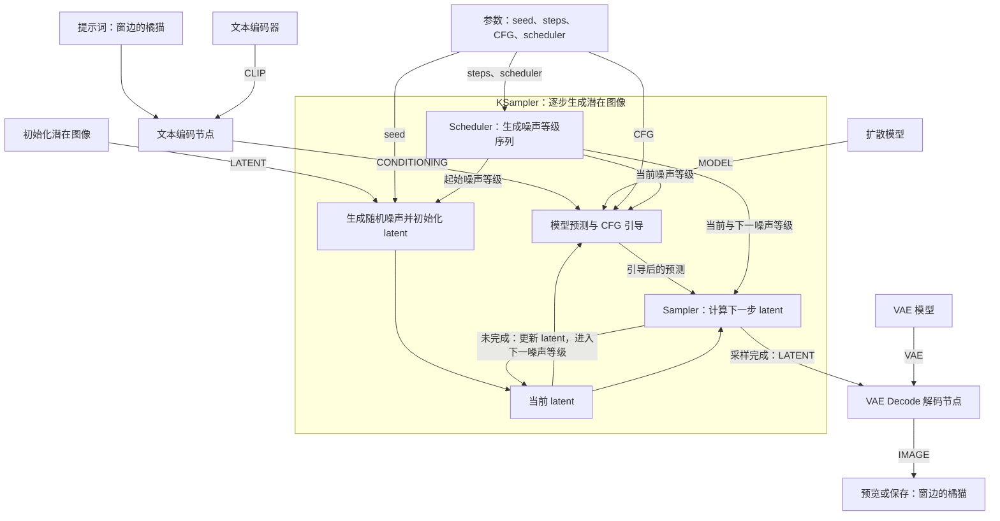

ComfyUI 的普通版 **K 采样器（KSampler）** 有 **4 个接线输入、1 个接线输出**。节点内通常能看到 **7 个可调项**，其中 6 个参与本次采样，`control_after_generate` 管理下一次运行的种子。[ComfyUI](https://docs.comfy.org/zh/built-in-nodes/sampling/ksampler?utm_source=chatgpt.com)

## 一、输入接口：KSampler 需要什么

| 接口           | 类型           | 代表什么                                           | 通常接哪里                                                                                           |
| -------------- | -------------- | -------------------------------------------------- | ---------------------------------------------------------------------------------------------------- |
| `model`        | `MODEL`        | **用哪个模型生成**                                 | 接 `Load Checkpoint` 的 `MODEL` 输出。使用 IP-Adapter 时，接 IP-Adapter 处理后的 `MODEL`。           |
| `positive`     | `CONDITIONING` | **希望画面出现什么**，例如「一个人在窗边举起右手」 | 接正向 `CLIP Text Encode` 的输出。使用姿势 ControlNet 时，接 `Apply ControlNet` 的 `positive` 输出。 |
| `negative`     | `CONDITIONING` | **希望画面减少什么**，例如「模糊、水印」           | 接负向 `CLIP Text Encode` 的输出。使用 ControlNet 时，接 `Apply ControlNet` 的 `negative` 输出。     |
| `latent_image` | `LATENT`       | **从什么画面基础开始**                             | 文生图接 `Empty Latent Image`，在上游设宽高。图生图接原图经过 `VAE Encode` 后的输出。                |

结合前面讲的 DWPose：它输出的**骨架图**接 `Apply ControlNet.image`，由 ControlNet 把姿势信息加入正、负条件，再送进 KSampler。这样，即使 `latent_image` 接的是空画布，生成的人物也能参考骨架摆姿势。[ComfyUI](https://docs.comfy.org/zh/built-in-nodes/sampling/ksampler?utm_source=chatgpt.com)

## 二、输出接口：KSampler 生成什么

| 接口                  | 输出内容                                               | 下一步接哪里                                                                              |
| --------------------- | ------------------------------------------------------ | ----------------------------------------------------------------------------------------- |
| `LATENT`（`samples`） | **采样后的潜空间图像**，也就是模型内部对画面的数字表示 | 接 `VAE Decode` 的 `samples` 输入，解码为 `IMAGE`，再接 `Preview Image` 或 `Save Image`。 |

因此，如果你想**预览最终图片**，要从 `VAE Decode` 的输出接预览。[ComfyUI](https://docs.comfy.org/zh/built-in-nodes/sampling/ksampler?utm_source=chatgpt.com)

## 三、节点内的 7 个可调项

| 分类       | 参数                                | 代表什么                              | 怎么理解或调整                                                                        |
| ---------- | ----------------------------------- | ------------------------------------- | ------------------------------------------------------------------------------------- |
| 随机起点   | `seed` 随机种子                     | 决定起始噪声的图案                    | 同一句提示词，换种子就可能换构图、姿势和细节。比较其他参数时先固定它。                |
| 种子管理   | `control_after_generate` 生成后控制 | 决定下一次运行怎么选种子              | `fixed` 保持，`randomize` 随机，`increment` 加 1，`decrement` 减 1。                  |
| 采样过程   | `steps` 步数                        | **整个过程走多少步**                  | 默认 `20`。增加步数通常更慢，画质收益会逐渐减小。适合的步数取决于模型。               |
| 采样过程   | `sampler_name` 采样器               | **每一步用什么算法更新画面**          | 例如 `euler`、`dpmpp_2m`。种子和步数相同，换算法也可能改变纹理和细节。                |
| 采样过程   | `scheduler` 调度器                  | **这些步分布在哪些噪声水平上**        | 例如 `normal`、`karras`。即使都是 20 步，也可以在高噪声和低噪声阶段采用不同的步距。   |
| 提示词引导 | `cfg` 引导强度                      | 控制正、负条件对生成方向的影响        | 标准 CFG 下，`1` 表示采用正向预测。继续调高会放大正、负预测的差异，过高可能损害画质。 |
| 原图重绘   | `denoise` 降噪强度                  | 控制从多高的噪声水平开始，范围 `0～1` | 常规文生图用 `1.0`。图生图里，值低通常更保留原图，值高则允许更大幅度重画。            |

例如，把同一张人物照片改成水彩时，固定 `seed`、提示词和 `steps`，只把 `denoise` 从 `0.3` 调到 `0.7`，就能观察**允许重画的幅度**怎样影响原图的姿势、衣服和背景。若你想比较**提示词引导有多强**，则固定 `denoise`，只改 `cfg`。[ComfyUI](https://docs.comfy.org/zh/built-in-nodes/sampling/ksampler?utm_source=chatgpt.com)

**在 ComfyUI 中，scheduler（调度器）的主要作用是：安排去噪过程中，每一步经过什么噪声等级。**

你已经理解了“模型预测、采样器更新 latent”。现在加上 scheduler：

> **模型提供预测，sampler 决定怎样计算更新，scheduler 决定这一小步从哪个噪声等级走到哪个等级。**

ComfyUI 的 `BasicScheduler` 节点，输出的就是一串噪声等级数值，类型叫 **`SIGMAS`**。[ComfyUI](https://docs.comfy.org/built-in-nodes/BasicScheduler?utm_source=chatgpt.com)

**1. 同样去噪 4 步，可以有不同安排**

用 \(\sigma\) 表示噪声等级。通常数值越大，表示噪声越强。

假设从噪声等级 `10` 开始，最终降到 `0`。下面是两种**教学示意安排，不是某个真实调度器的输出**：

| 调度安排          | 起点 | 第 1 步后 | 第 2 步后 | 第 3 步后 | 第 4 步后 |
| ----------------- | ---: | --------: | --------: | --------: | --------: |
| A：间隔比较均匀   |   10 |         7 |         4 |         1 |         0 |
| B：后段安排得更密 |   10 |         4 |         1 |       0.2 |         0 |

两者都是 4 步，但：

- **A**：在高、中、低噪声区域都安排了更新。
- **B**：前面跨得比较大，更多更新安排在低噪声区域。

因此，**steps 决定走多少步；scheduler 决定这些步分布在哪里。**

这里的 `10`、`0.2` 是噪声等级，不是“有 10% 或 20% 的像素属于噪点”。

**2. 为什么分布不同，会影响最后的橘猫？**

仍然生成：

> 一只橘猫坐在窗边，温暖的阳光照在身上。

在较高噪声阶段，画面有很大的变化空间；在较低噪声阶段，已有结构通常更明确，后续调整往往更细。

你可以直观地理解为：

| 阶段     | 常见的变化倾向                 |
| -------- | ------------------------------ |
| 高噪声   | 形成整体布局、主体和大致形状   |
| 中等噪声 | 协调猫、窗户、光照等结构与关系 |
| 低噪声   | 调整纹理、边缘和细节           |

这是一种帮助理解的概括，**模型没有规定“第 5 步画猫，第 10 步画胡须”**。

如果某段跨得太大，模型预测的误差可能被放大；在合适的位置增加计算，可以更准确地沿生成路径推进。噪声等级的分配与数值求解方法，都会影响质量和计算效率。[arxiv.org](https://arxiv.org/abs/2206.00364?utm_source=chatgpt.com)

**3. scheduler 怎样参与每一步计算？**

假设当前噪声等级为 `4`，scheduler 指定下一步到 `1`：

1. 将当前 latent、当前噪声等级和 CONDITIONING 交给模型。
2. 模型给出预测。
3. sampler 根据预测，以及 `4 → 1` 这个跨度，计算新的 latent。
4. 到下一等级后，再重新调用模型。

以简单的 **Euler 采样器**为例，在对应的噪声参数化下，更新形式是：

\[
z*{\text{下一步}}
=
z*{\text{当前}}

- (\sigma*{\text{下一步}}-\sigma*{\text{当前}})\,d
  \]

这里的 \(d\) 是**根据模型预测计算出的变化率**。

因此：

- scheduler 提供当前和下一步的 \(\sigma\)。
- 模型预测用于计算 \(d\)。
- Euler sampler 按上面的公式更新 latent。

如果下一等级从 `1` 改成 `3`，这次更新的跨度就不同；后续 latent 不同，下一次模型预测也会随之变化。ComfyUI 的 Euler 实现正是这样使用噪声等级差值的。[GitHub](https://github.com/Comfy-Org/ComfyUI/blob/master/comfy/k_diffusion/sampling.py?utm_source=chatgpt.com)

**4. 把几个容易混淆的参数放在一起**

| 项目             | 回答的问题                                     |
| ---------------- | ---------------------------------------------- |
| **CONDITIONING** | 这次希望生成什么？                             |
| **MODEL**        | 当前状态下，应该做出什么预测？                 |
| **sampler**      | 使用什么数学算法更新 latent？                  |
| **scheduler**    | 依次经过哪些噪声等级？                         |
| **steps**        | 使用多少个采样步骤？                           |
| **denoise**      | 从多强的噪声状态开始处理，允许多大程度的改动？ |

在常见图生图流程里，较低的 `denoise` 通常对应从较低噪声等级开始，因此更容易保留原图结构。**`denoise = 0.5` 不表示精确保留原图的 50%。**[ComfyUI](https://docs.comfy.org/built-in-nodes/sampling/ksampler?utm_source=chatgpt.com)

**常见 scheduler 名称，主要区别在“如何选取等级”**

| 名称          | 核心方式                                                                |
| ------------- | ----------------------------------------------------------------------- |
| `normal`      | 在模型的时间步坐标上等间隔取点，再转换成噪声等级；不一定是 sigma 等间隔 |
| `simple`      | 从模型已有的噪声等级序列中按索引间隔取点                                |
| `karras`      | 使用幂次形式安排 sigma，在不同噪声区间分配采样点                        |
| `exponential` | 在 log sigma 空间等间隔取点，sigma 按比例变化                           |

它们不是“普通画质、高清画质、快速模式”的固定档位。效果取决于模型、采样器和步数的配合。[GitHub](https://github.com/Comfy-Org/ComfyUI/blob/master/comfy/samplers.py?utm_source=chatgpt.com)

最后补充一个术语差异：**ComfyUI 把 sampler 和 scheduler 分成两个选项；Diffusers 中名叫 `Scheduler` 的类，往往同时负责噪声等级安排和每一步更新公式。**所以你在代码里看到 `scheduler.step()`，它承担的职责可能比 ComfyUI 的 `scheduler` 下拉选项更广。[Hugging Face](https://huggingface.co/docs/diffusers/api/schedulers/overview?utm_source=chatgpt.com)
