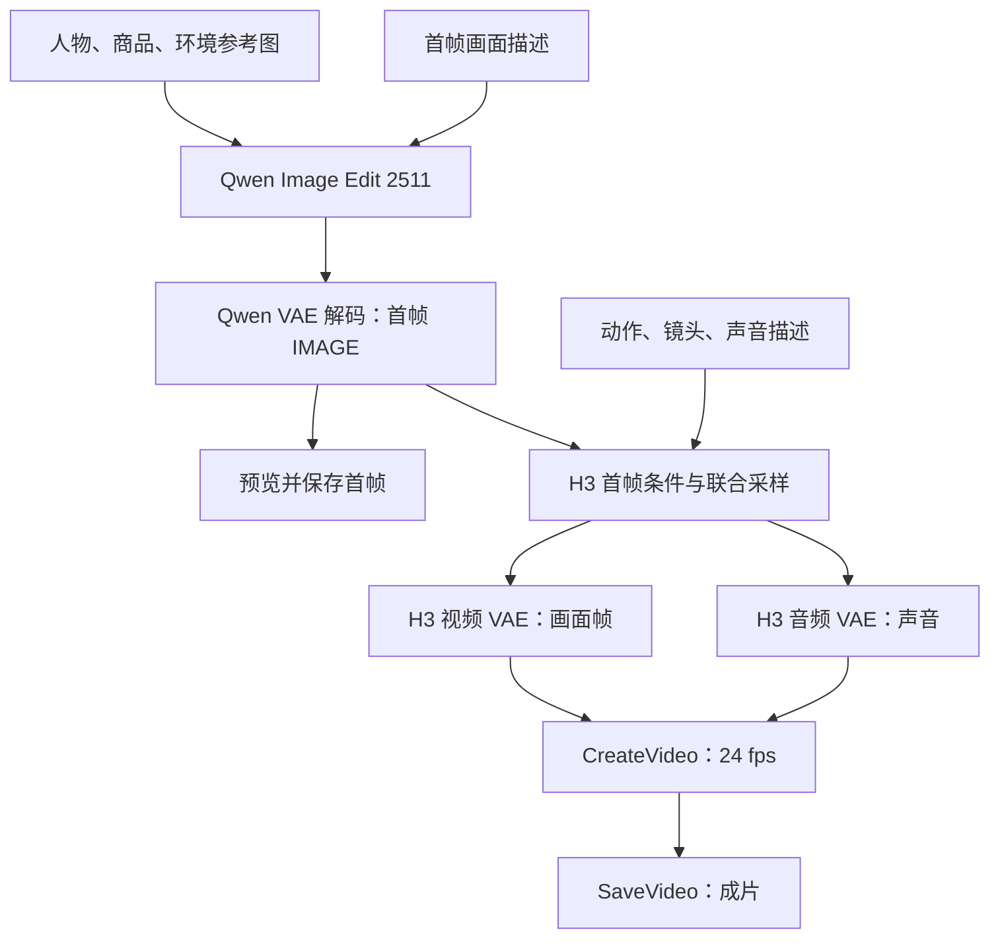

# Qwen 首帧 + MiniMax H3 视频工作流

更新日期：2026-11-10。

本次依据你上传的 ComfyUI 工作流和模型列表，制作了两份可导入的普通工作流 JSON。沿用原例子“网球场中的人物拿着汽水”，把 Gemini 首帧生成和 Kling 视频生成替换成 Qwen 与 MiniMax H3 的原生模型节点。

**建议保留原来的人物、商品、环境参考图时使用 01；只从文字创建画面时使用 02。** 两份工作流默认都会连续生成首帧和视频，并保存中间首帧。

已完成 JSON 解析、节点和连接编号、输入输出类型、连接回指、无环拓扑、首帧跨阶段连接及音频支路检查。没有连接你的 ComfyUI 实例，也没有执行 GPU 推理。因此，文件不代表已实测的视频效果或运行速度；实际运行还取决于节点版本、模型依赖和设备资源。

## 1. 文件怎么选

| 文件 | 输入 | 首帧模型 | 视频模型 |
|---|---|---|---|
| `01_Qwen_Edit_2511_MiniMaxH3_References.json` | 人物、商品、环境参考图 + 画面描述 + 动作/声音描述 | Qwen Image Edit 2511 INT8 | MiniMax H3 FL2VA |
| `02_Qwen_Image_2512_MiniMaxH3_TextToVideo.json` | 画面描述 + 动作/声音描述 | Qwen Image 2512 FP8 | MiniMax H3 FL2VA |

两份文件都使用核心节点，未增加第三方自定义节点或 Lightning LoRA 依赖。核心节点仍需要你的 ComfyUI 版本支持。

## 2. 和原流程相比改了什么

原流程上半段用 Gemini 接收人物、商品和环境三张图，生成一张场景图；下半段使用单独的 `FIRST FRAME / LoadImage`，再把首帧、人物、商品打包给 Kling。

原 JSON 的 Gemini 输出只连到了 `SaveImage`，没有自动送到视频分支。新版把 Qwen 解码后的 `IMAGE` 同时连接到 `SaveImage` 与 H3 的 `first_frame`，因此一次运行即可连贯执行。

需要注意三项行为差异：

1. **视频阶段的参考方式改变。** 01 先将三张参考图合成一张首帧，H3 FL2VA 再依据这张首帧生成。人物和商品不会作为独立参考图再次进入视频阶段。不能把这理解成与原 Kling Omni 三图参考能力完全相同。
2. **02 不指定参考身份。** 纯文生图能生成描述中的人物和商品，但没有读取你指定的头像或产品原图。需要这类引用时选择 01。
3. **保留了 H3 原生音频。** 视频采样结果同时进入视频 VAE 与音频 VAE，再合成 VIDEO。示例提示词要求环境声，没有对白和背景音乐；这是生成指令，效果仍需听取成片确认。

Qwen Image Edit 2511 支持多图编辑并改善人物一致性，但不保证每一次生成都完全保留人脸、商品小字和商标。先检查首帧更适合这种制作流程。[1][2]

## 3. 总体流程

02 将上面的 Qwen Edit 替换为 Qwen Image 2512，并去掉三张参考图。后面的 H3 链路相同。

**两个模型之间传递的是 IMAGE。** Qwen 的潜在空间数据必须先用 Qwen VAE 解码成图片；H3 再用自己的编码器和视频 VAE 读取图片，生成自己的条件和音视频潜在空间。两者的 `LATENT` 不能直接跨模型连接。[3][4]

## 4. 导入与运行

### 01：保留人物、商品、环境参考

1. 将 `01_Qwen_Edit_2511_MiniMaxH3_References.json` 拖进 ComfyUI。
2. 在左上区域的三个 `LoadImage` 节点上传人物、商品、环境图片。工作流中的 `UPLOAD_PERSON.png`、`UPLOAD_PRODUCT.png`、`UPLOAD_ENVIRONMENT.png` 是占位名，并不包含图片；此次附件也没有这些原始素材。
3. 修改绿色的“首帧画面与三图角色”节点。默认图1=人物，图2=商品，图3=环境。
4. 修改下方绿色的“动作、镜头、声音与视频尺寸”节点。
5. 检查模型、文本编码器和 VAE 的下拉选择，再运行。

**没有商品图或环境图：** 删除对应的 `LoadImage` 节点，ComfyUI 会一并移除它连向正、负编码器的两条线；再把提示词中对该参考图的引用改成文字描述。不要仅清空文件名。若手动断线，需要同时断开正面和负面编码器的输入。

如果删除了中间的参考图，建议同时按剩余图的顺序重新整理 `image1/image2/image3` 输入和提示词编号，避免“第2张图”指代错位。人物图保留在 `image1` 最容易管理。

### 02：纯文字生成

1. 将 `02_Qwen_Image_2512_MiniMaxH3_TextToVideo.json` 拖进 ComfyUI。
2. 修改“首帧画面描述”。这里写人物、场景、构图、光线和物体的位置。
3. 修改下方 H3 节点中的动作、镜头和声音描述。
4. 检查各模型下拉选择后运行。不需要上传参考图。

### 先确认首帧，再生成视频

两份文件默认连续执行。若要分两次制作：

1. 将右下角 `SaveVideo` 节点设置为 **Mute / Never（静音）**，让 `SaveImage` 保持启用。
2. 运行并调整首帧。
3. 首帧满意后，把 `SaveVideo` 恢复为 **Always**，保持图像采样器的 seed 为 `fixed`，再运行。
4. 只改变 H3 的动作提示词时，图像分支在缓存仍有效的条件下可以复用结果。若重启、清空缓存或改变上游输入，可能重新执行首帧生成。

这里使用输出节点的静音功能。不要通过 Bypass 中间 H3 节点来实现“只运行首帧”，因为该节点输入输出并不属于可直接互相透传的同一种数据。

若必须固定某一张已挑选的图片，也可以新建 `LoadImage`，上传已保存的首帧，替换 H3 的 `first_frame` 连接；同时静音原 `SaveImage`，避免仍然触发图像生成分支。

## 5. 默认参数

下表是这次文件的实际设置。1024×576 是便于先确认全链路的预览配置，不是质量最优结论。

| 项目 | 01：Qwen Edit | 02：Qwen Image | H3 视频阶段 |
|---|---:|---:|---:|
| 宽 × 高 | 1024×576 | 1024×576 | 1024×576 |
| 批量 | 1 | 1 | 单条视频 |
| steps | 40 | 50 | 20 |
| CFG | 4 | 4 | 使用官方基础 `BasicGuider` 链路，无单独 CFG 控件 |
| sampler | euler | euler | res_multistep |
| scheduler | simple | simple | simple |
| denoise | 1 | 1 | 1 |
| 图像模型 shift | 3.1 | 3.1 | 不套用 Qwen 的 shift 节点 |
| seed | 314159265，fixed | 314159265，fixed | 42，fixed |
| 视频 length | — | — | 124 帧 |
| 输出 fps | — | — | 24 |
| 时长 | — | — | 约 5.17 秒 |

Qwen Edit 的 CFG 4 与空负面提示词沿用当前官方 INT8 编辑模板关闭 Lightning 时的有效配置；标准文生图使用官方 50 步配置。此次没有配置加速 LoRA，不应直接套用 4 步或 8 步的 Lightning 参数。[2][5]

H3 的帧数按 `17k+5` 对齐。124 帧 / 24 fps = 5.1667 秒，所以这里没有把它称作“精确 5 秒”。H3 的 `first_frame` 会按目标画布缩放；保持首帧和视频尺寸一致，可以避免比例不匹配带来的拉伸。[3][6]

### 改成竖屏

同时修改两处：

- Qwen 的 `EmptySD3LatentImage`：width=576，height=1024。
- H3 的 `MiniMaxH3ImageToVideo`：width=576，height=1024。

把画面提示词中的横屏描述也改成竖屏。不要只修改其中一处。

### 提高分辨率

可把两处画布同时改成 1344×768，或根据设备能力使用其他适合 H3 的 32 像素倍数尺寸。1344×768 接近横屏，但并非数学上精确的 16:9。提高分辨率前，先完成默认配置的试跑。[6]

如果希望先用 Qwen 生成更高分辨率的首帧，再以较小尺寸交给 H3，应在两者之间明确增加等比裁切/缩放节点。不要让两种不同宽高比隐式相互拉伸。

## 6. 必需模型与目录

截图显示的是扩散模型选择列表，不能据此判断文本编码器和 VAE 是否已经齐全。导入后请分别检查这些下拉框。

### 两个版本共用的图像依赖

| 作用 | 文件 | 本地目录 |
|---|---|---|
| Qwen 文本/视觉编码器 | `qwen_2.5_vl_7b_fp8_scaled.safetensors` | `ComfyUI/models/text_encoders/` |
| Qwen 图像 VAE | `qwen_image_vae.safetensors` | `ComfyUI/models/vae/` |

`CLIPLoader.type` 使用 `qwen_image`。

### 根据版本选择一个图像模型

| 版本 | 文件 | 本地目录 |
|---|---|---|
| 01 多参考图 | `qwen_image_edit_2511_int8_convrot.safetensors` | `ComfyUI/models/diffusion_models/` |
| 02 纯文生图 | `qwen_image_2512_fp8_e4m3fn.safetensors` | `ComfyUI/models/diffusion_models/` |

### 两个版本共用的 H3 依赖

| 作用 | 文件 | 本地目录 |
|---|---|---|
| H3 首帧视频扩散模型 | `minimax_h3_fl2va_pruned_int8_convrot.safetensors` | `ComfyUI/models/diffusion_models/` |
| H3 文本/视觉编码器 | `qwen3vl_32b_minimax_h3_nvfp4_awq.safetensors` | `ComfyUI/models/text_encoders/` |
| H3 视频 VAE | `minimax_h3_video_vae_int8_convrot.safetensors` | `ComfyUI/models/vae/` |
| H3 音频 VAE | `minimax_h3_audio_vae_fp32.safetensors` | `ComfyUI/models/vae/` |

H3 的 `CLIPLoader.type` 使用 `minimax`。所有 UNETLoader 的 `weight_dtype` 使用 `default`。如果平台显示模型名时不含 `.safetensors`，从下拉列表选择对应条目；不要猜测其他文件名或混用另一架构的编码器。[6][7]

工作流中的模型属性保留了官方模型下载信息。运行于 Comfy Cloud 时以平台下拉列表和可用依赖为准；本地部署时按上表放置文件。INT8 convrot 是否能在本地正常加载，还取决于 ComfyUI、PyTorch 和相应量化支持，文件名存在不等于环境已兼容。[7]

## 7. 为什么选这两个图像模型

| 你列表中的模型 | 适合的任务 | 本次选择 |
|---|---|---|
| `qwen_image_2512_fp8_e4m3fn` | 纯文字生成画面 | 02 的默认模型 |
| `qwen_image_edit_2511_int8_convrot` | 依据人物、商品、环境参考图编辑或合成画面 | 01 的默认模型 |
| `qwen_image_edit_2511_bf16` | 同类编辑任务的 BF16 权重选择 | 若环境资源足够，可在 01 中改选该模型 |
| `qwen_image_edit_2509_fp8_e4m3fn` | 较早版本的参考图编辑 | 本次优先选择列表已有的 2511 |
| `z_image_turbo_bf16` | 快速生成纯文字首帧 | 可作为后续速度方案，未包含于本次两个 JSON |
| `Flux.1-fill-dev` | 局部重绘、扩图 | 不作为本次从文字生成整张首帧的默认选择 |

Qwen Image 2512 是文生图模型；Qwen Image Edit 2511 是参考编辑模型。两者承担不同任务。[1][5]

Z Image Turbo 的官方工作流采用自己的编码器与 VAE：`qwen_3_4b.safetensors`、`ae.safetensors`，并使用不同的采样配置。若切换到 Z Image，应替换整个首帧生成模块，最后仍以 `IMAGE` 连接 H3；不能只把 Qwen 的模型下拉改成 Z Image。[8]

FLUX.1 Fill 的官方定位是 inpainting / outpainting。它可以用于首帧局部修复，但不是这里替代 Qwen 文生图分支的直接选项。[9]

## 8. H3 的两个模型怎么区分

| 模型 | 对应节点 | 参考图的作用 |
|---|---|---|
| `minimax_h3_fl2va_pruned_int8_convrot` | `MiniMaxH3ImageToVideo` | 首帧和可选末帧约束；本次两份文件使用它 |
| `minimax_h3_ref2va_pruned_int8_convrot` | `MiniMaxH3ReferenceToVideo` | 多张参考图、视频或音频提供身份、风格、动作等信息 |

本次目标是“先做好一张首帧，再让这张图动起来”，因此选择 FL2VA。[3][6]

如果以后要把人物、商品分别送进 H3 的视频阶段，需要采用 REF2VA 的完整参考链路，并在提示词中使用相应的 `<Picture 1>` 等标签。参考图片并不自动等同于严格锁定第一帧；如果还需时间点或首帧锚定，应另行配置官方引导节点，不能只改模型文件名。[3][6]

## 9. 两段提示词怎么写

### 首帧：描述静止的画面

重点是“有什么、在哪里、长什么样、相机怎样构图”。

> 写实广告首帧，横屏中景。一位穿白色网球服的成年女性站在球网旁，右手在胸前拿着一罐汽水，尚未喝下。脸部和罐身清晰可见，温暖侧光，人物神态轻松，画面留出手臂活动空间。

使用 01 时再说明图1、图2、图3分别提供哪些信息。避免把三张参考图要求写成三格拼贴。

### 视频：描述动作、镜头与声音

重点是“接下来发生什么”。

> 一个连续镜头。人物自然地举起手中的饮料，轻啜一口，随后放低并微笑看向罐身。相机缓慢向前推进，动作自然克制，保持人物、服装、产品和环境一致。声音是安静的球场环境声、轻微衣物摩擦和饮水声，没有对白与背景音乐。

这个约5秒的例子使用一组连贯小动作。若改成完全不同场景，请同步改首帧与视频描述，避免视频仍要求网球场饮水动作。

## 10. 常见问题

| 现象 | 先检查什么 |
|---|---|
| 缺少 `MiniMaxH3ImageToVideo` 或其他红色节点 | ComfyUI 是否包含相应核心节点；本流程不要求额外安装某个社区 H3 包 |
| 模型名不在列表 | 区分扩散模型、文本编码器、VAE 三种目录；从下拉选择实际存在的对应文件 |
| 01 报参考图不存在 | 占位名必须换成上传图片；不用的参考图应删除对应 LoadImage 并修改提示词 |
| 人物变形、画面被拉宽 | 检查 Qwen 目标宽高与 H3 宽高是否一致 |
| 改视频提示词后首帧也变了 | 检查图像 seed 是否 fixed，上游图片/提示词是否改变，缓存是否仍有效 |
| 没有声音 | 检查 `VAEDecodeAudio → CreateVideo.audio` 是否连接，以及音频 VAE 是否正确 |
| 人物或商品细节不稳定 | 先检查并挑选首帧；缩小动作幅度，避免遮挡与复杂旋转；必要时另做 REF2VA 参考流程 |
| 显存不足 | 先保持批量1与默认预览分辨率，减少同时占用的模型；本文件未对你的硬件做性能测试 |

## 11. 官方依据

以下链接用于核对节点、模型依赖和改动依据；不需要全部阅读即可运行。

1. Qwen Image Edit 2511 官方模型卡：<https://huggingface.co/Qwen/Qwen-Image-Edit-2511>
2. ComfyUI 官方 Qwen Image Edit 2511 INT8 模板：<https://github.com/Comfy-Org/workflow_templates/blob/main/templates/image_qwen_image_edit_2511_int8.json>
3. ComfyUI H3 节点源码：<https://github.com/Comfy-Org/ComfyUI/blob/master/comfy_extras/nodes_minimax_h3.py>
4. ComfyUI Qwen 节点源码：<https://github.com/Comfy-Org/ComfyUI/blob/master/comfy_extras/nodes_qwen.py>
5. ComfyUI Qwen Image 2512 官方教程：<https://docs.comfy.org/tutorials/image/qwen/qwen-image-2512>
6. ComfyUI MiniMax H3 原生工作流教程：<https://docs.comfy.org/tutorials/video/minimax/minimax-h3-native>
7. ComfyUI H3 模型仓库：<https://huggingface.co/Comfy-Org/MiniMax-H3>
8. ComfyUI Z Image Turbo 官方教程：<https://docs.comfy.org/tutorials/image/z-image/z-image-turbo>
9. ComfyUI FLUX.1 Fill 官方教程：<https://docs.comfy.org/tutorials/flux/flux-1-fill-dev>
10. ComfyUI H3 I2V 官方模板：<https://github.com/Comfy-Org/workflow_templates/blob/main/templates/video_minimax_h3_i2v.json>
11. Diffusers 官方 Qwen Edit Plus 实现：<https://github.com/huggingface/diffusers/blob/main/src/diffusers/pipelines/qwenimage/pipeline_qwenimage_edit_plus.py>

### 本次明确做过的工程适配

01 将常规编辑模板从图1的 VAEEncode 获取目标画布，改为 `EmptySD3LatentImage(1024,576,1)`。参考图片仍分别进入 `TextEncodeQwenImageEditPlus` 的视觉与 VAE 参考条件。这样人物头像不必决定最终广告的画面比例。Qwen 官方实现将参考图 latent 与目标噪声 latent 分开处理，这是该适配的依据，但这份组合仍需实际生成验证。[4][11]

H3 部分从官方模板展开成普通节点，移除了可选 Turbo LoRA、开关与时长换算封装，直接使用124帧。输出保持视频、音频双解码和24fps合成。[10]
